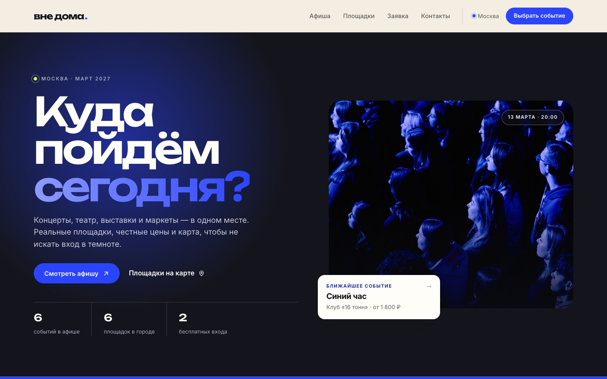

# «Вне дома» — афиша городских событий

Многостраничный сайт-афиша Москвы: концерты, театр, выставки, мастер-классы,
кино и маркеты. Двенадцать событий, шесть реальных площадок, карта, маршруты и заявки,
которые не требуют сервера.

[](https://tyomagit.github.io/afisha-events/)

**Живая версия:** <https://tyomagit.github.io/afisha-events/>
**Репозиторий:** <https://github.com/tyomagit/afisha-events>

## О проекте

«Вне дома» — это самостоятельный продукт: афиша, в которой событие можно найти
за пару минут, посмотреть площадку на карте и оставить заявку, не создавая аккаунт.
Дизайн построен вокруг контраста тёмного hero-блока и кремовой «бумаги», крупной
типографики Unbounded и электрического синего акцента.

Сайт полностью статический. Это не ограничение, а осознанное решение: афиша
разворачивается на GitHub Pages, работает без сборки и серверной части, а заявки
сохраняются в `localStorage` браузера. Никакие данные не покидают устройство
пользователя — об этом честно сказано в формах и FAQ.

События и цены — вымышленный контент для демонстрации продукта. Площадки, адреса
и координаты — реальные.

## Возможности

- **Главная** — тёмный hero с ближайшим событием, бегущая строка, подборка
  «Ближайшие события», интерактивная карта площадок, три шага до вечера
  и подписка на дайджест.
- **Каталог** — поиск по названию, фильтры по категории, дате и цене, сортировка,
  счётчик результатов и состояние «ничего не найдено». Категорию можно передать
  ссылкой: `catalog.html?category=concert`.
- **Страница события** — контент подставляется из `js/events.js` по параметру
  `?event=`: описание, особенности, таблица билетов, карта, маршрут, похожие
  события и JSON-LD для поисковиков.
- **Заявка** — форма с валидацией, автоматическим заполнением из карточки события,
  живым пересчётом суммы и подтверждением с номером заявки. Всё сохраняется
  в браузере.
- **Контакты** — форма обратной связи, карточки всех шести площадок со ссылками
  на Яндекс Карты и маршруты, FAQ на нативном `<details>`.
- **Общее** — адаптивная вёрстка от 320 px, доступная клавиатурная навигация,
  skip-link, видимый фокус, `prefers-reduced-motion`, модальное окно быстрой
  заявки с возвратом фокуса, кнопка «Наверх», 404-страница, `robots.txt`
  и `sitemap.xml`.

## Страницы

| Файл            | Назначение                                                     |
| --------------- | -------------------------------------------------------------- |
| `index.html`    | Главная: hero, подборка, карта площадок, шаги, подписка        |
| `catalog.html`  | Каталог с фильтрами и сортировкой                              |
| `product.html`  | Страница события, выбирается через `?event=<id>`               |
| `order.html`    | Заявка на событие                                              |
| `contacts.html` | Контакты, площадки и частые вопросы                            |
| `404.html`      | Страница ошибки для GitHub Pages                               |

## Стек

- HTML5, CSS3 (кастомные свойства, grid, flexbox), vanilla JavaScript без фреймворков.
- **Bootstrap 5.3.8** подключён локально из `vendor/bootstrap/` — используется
  для модального окна и базовых стилей; вся визуальная система живёт
  в `css/custom.css`.
- Шрифты Google Fonts: **Unbounded** для заголовков и **Inter** для текста.
- **Яндекс Карты**: статичная карта с меткой через Static API и глубокие ссылки
  на карту и маршрут. Без рекламных виджетов и API-ключей.
- `localStorage` для заявок и подписок, JSON-LD для разметки события.
- Хостинг: **GitHub Pages** (ветка `main`, корень репозитория, `.nojekyll`).

## Структура

```text
.
├── index.html · catalog.html · product.html · order.html · contacts.html · 404.html
├── css/
│   └── custom.css          # дизайн-система и все компоненты
├── js/
│   ├── events.js           # данные событий + ссылки на Яндекс Карты
│   └── main.js             # каталог, страница события, формы, модалка, анимации
├── images/                 # постеры событий, иконка, превью для README
├── vendor/bootstrap/       # Bootstrap 5.3.8 (CSS + JS bundle)
├── robots.txt · sitemap.xml · .nojekyll
└── README.md
```

## Локальный запуск

Сборка не нужна — достаточно статического сервера из корня проекта:

```sh
python3 -m http.server 8000
```

Затем откройте <http://localhost:8000>. Сервер нужен, чтобы корректно работали
query-параметры (`?event=`, `?category=`) и одинаковые пути на всех страницах.

## Как это устроено

`js/events.js` — единственный источник данных о событиях: название, категория,
дата, площадка, адрес, метро, координаты, цена, постер, описание и особенности.
Там же — хелперы `yandexMapUrl()`, `yandexRouteUrl()` и `yandexStaticMapUrl()`,
которые собирают ссылки на карту и маршрут.

`js/main.js` — слой поведения:

- `initHome()` — ближайшие события, счётчики афиши и жанров;
- `initCatalog()` — рендер карточек, фильтры, сортировка, счётчик, пустое состояние;
- `initEventPage()` — рендер страницы события, билетов, карты, похожих событий;
- `initVenues()` — переключение площадок и карты на главной;
- `initEventSelects()` — единый список событий в формах заявки;
- `initForms()` / `saveRequest()` — валидация и сохранение заявок;
- `updateOrderSummary()` — живой пересчёт итога;
- `initModal()` — быстрая заявка с возвратом фокуса;
- `initTicker()`, `initReveal()`, `initHeader()`, `initBackTop()` — интерфейсные детали.

Чтобы добавить событие, достаточно дописать объект в массив `events` — каталог,
страница события, карточки, формы и карта подхватят его автоматически.

## Приватность

Заявки и подписки сохраняются только в браузере пользователя, в ключах
`vne-doma:requests` и `vne-doma:subscribers`. Сервера, аналитики и трекеров нет.
Очистка данных сайта в браузере удаляет и заявки.

## Автор

Мацейко А. В. — [@tyomagit](https://github.com/tyomagit)
